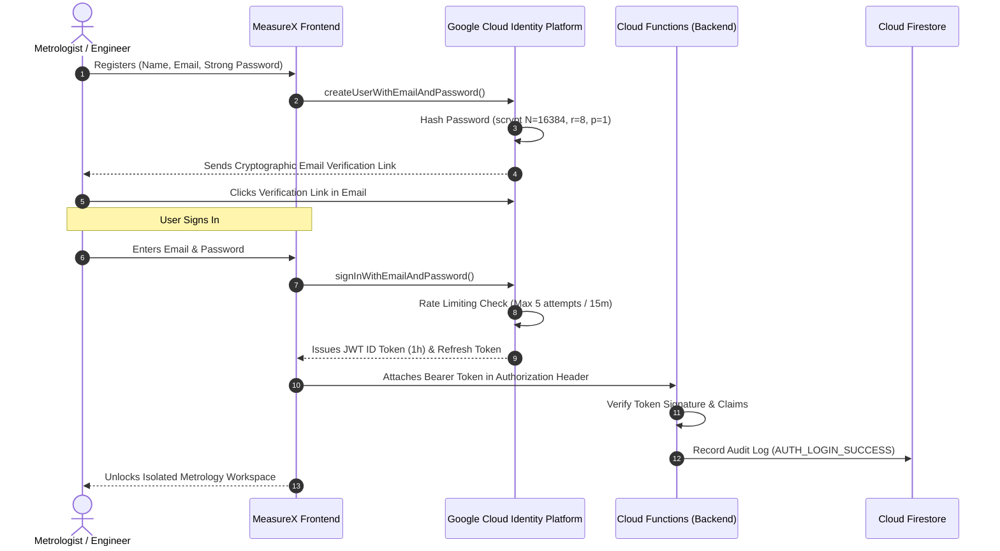

# MEASUREX – USER AUTHENTICATION & IDENTITY DESIGN (PHASE 3)
**Document Version:** 1.0.0  
**Target Architecture:** Google Cloud Identity Platform & Firebase Auth  
**Compliance Standards:** NIST SP 800-63B, OWASP ASVS v4.0 Level 2  

---

## 1. Identity Architecture Overview

MeasureX authenticates users using **cryptographically signed JSON Web Tokens (JWT)** issued by Google Cloud Identity Platform. Plain-text passwords, client-side session arrays, and unhashed credentials in `localStorage` are completely eliminated.

---

## 2. Authentication Workflows

### 2.1 Registration & Mandatory Email Verification
1. User supplies **Full Name**, **Email Address**, and **Password**.
2. **Password Strength Policy**:
   - Minimum length: 10 characters.
   - Must contain: at least 1 uppercase letter, 1 lowercase letter, 1 number, and 1 special symbol (`!@#$%^&*`).
   - Common breached password dictionary check (NIST SP 800-63B).
3. Upon account creation, Firebase Auth automatically dispatches a signed activation email (`sendEmailVerification()`).
4. **Enforcement Gate**: While unverified accounts can explore free offline rulers, **Cloud Sync, Project Saving, and Premium Instruments require `emailVerified == true`**.

### 2.2 Secure Sign-In & Session Lifecycle
- Upon valid credential presentation, Identity Platform returns:
  - **ID Token (JWT)**: Valid for 60 minutes. Contains standard claims (`sub`, `email`, `email_verified`) and custom claims (`plan: 'pro'`).
  - **Refresh Token**: High-entropy opaque token stored securely by the browser runtime in an `IndexedDB` cryptographic store (never in vulnerable `localStorage`).
- **Token Rotation**: The client SDK automatically exchanges the refresh token every 55 minutes to maintain active sessions without user disruption.

### 2.3 Sign-Out & Instant Session Revocation
- **Client Sign-Out**: `firebase.auth().signOut()` immediately purges tokens from memory and local IndexedDB.
- **Server-Side Session Revocation**: In security incident scenarios (e.g., compromised laptop, password change, suspicious login), an admin or the user can invoke the cloud function `revokeUserSessions(uid)`. This calls Firebase Admin SDK `admin.auth().revokeRefreshTokens(uid)` which updates `validSince` timestamp, instantly invalidating all issued tokens across all devices.

### 2.4 Self-Service Password Reset
- Password reset follows an out-of-band workflow:
  1. User requests password reset in `AuthModal.tsx`.
  2. Cloud Identity Platform generates a cryptographically random, one-time action code and emails it to the user (`sendPasswordResetEmail`).
  3. Action link directs user to a secure HTTPS reset endpoint hosted on Firebase Hosting.
  4. Once updated, all active sessions and existing refresh tokens for that user are immediately revoked.

### 2.5 Google Single Sign-On (OAuth 2.0)
- Supports one-click Google Sign-In for corporate engineering teams and universities using Google Workspace.
- Implements PKCE (Proof Key for Code Exchange) to mitigate OAuth authorization code interception.

---

## 3. Brute-Force & Rate Limiting Controls

To protect user accounts from credential stuffing and dictionary attacks:

1. **IP-Based Throttling**:
   - Cloud Identity Platform enforces automatic rate limiting on IP addresses exceeding 30 attempts per minute.
2. **Account Lockout Policy**:
   - After 5 consecutive failed login attempts on an account, Identity Platform enters a progressive backoff penalty (1 minute, 5 minutes, 15 minutes).
3. **App Check Protection**:
   - Every authentication request must carry a valid Firebase App Check attestation token (reCAPTCHA Enterprise), preventing automated bot scripts from calling auth endpoints directly.

---

## 4. Multi-Factor Authentication (MFA) for Enterprise Labs

For Enterprise Lab accounts and Metrology Directors managing confidential defense/aerospace components:

- **Supported Second Factors**:
  - Time-based One-Time Password (TOTP) compatible with Google Authenticator, Authy, and 1Password.
  - SMS One-Time Passcode (secondary fallback).
- **Enforcement**:
  - Organization admins can configure mandatory MFA for all team members under their Enterprise seat.
  - When enabled, `signInWithEmailAndPassword` throws an `auth/multi-factor-auth-required` challenge requiring the second factor verification before any session tokens are issued.

---

## 5. Role-Based Access Control (RBAC) Matrix

User permissions are encoded into Firebase Custom Claims issued strictly by server-side Cloud Functions:

| Capability | Free Metrologist | Pro Engineer | Enterprise Lab Director | System Admin |
|---|:---:|:---:|:---:|:---:|
| **Digital Rulers & Basic Caliper** | ✅ | ✅ | ✅ | ✅ |
| **All 15 Scientific Instruments** | ❌ (Free preview only) | ✅ | ✅ | ✅ |
| **Cloud Project Sync & Saving** | ❌ (Local only, max 5) | ✅ (Unlimited) | ✅ (Unlimited) | ✅ |
| **Official PDF Engineering Reports** | ❌ | ✅ | ✅ | ✅ |
| **CAD DXF Export** | ❌ | ❌ | ✅ | ✅ |
| **Multi-Seat Team Workspace** | ❌ | ❌ | ✅ | ✅ |
| **Audit Logs Access** | ❌ | ❌ | ✅ (Own team) | ✅ (Full platform) |
| **Manage Subscription / Seats** | ❌ | ✅ (Personal) | ✅ (Team organization) | ✅ |
