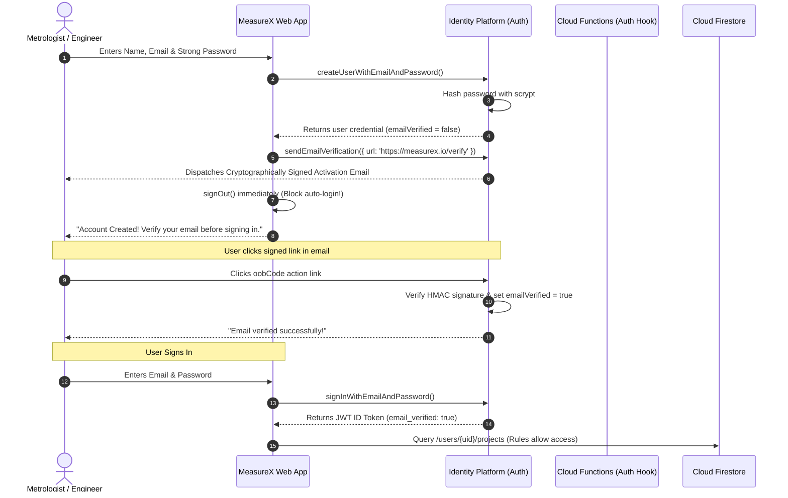
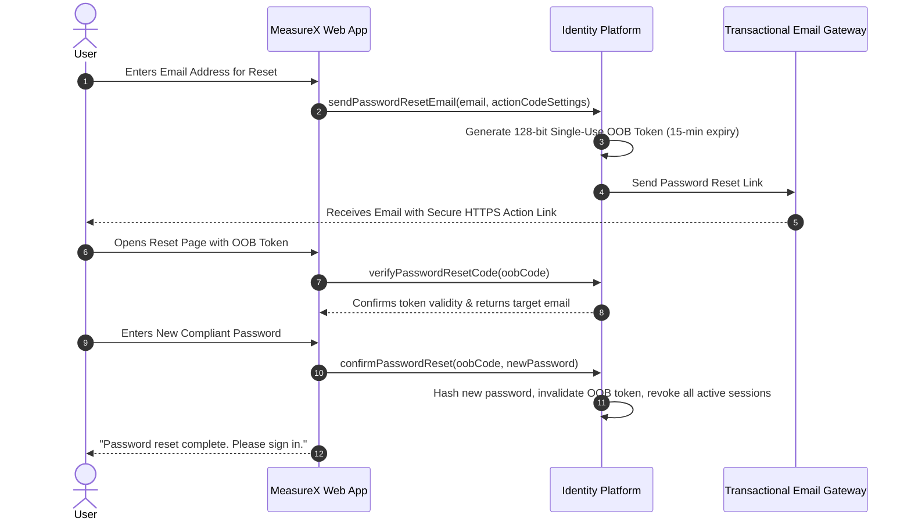

# MEASUREX – AUTHENTICATION SECURITY SPECIFICATION
**Document Version:** 1.0.0  
**Security Baseline:** NIST SP 800-63B (AAL2), OWASP ASVS v4.0 (Authentication Verification)  
**Target Identity Provider:** Google Cloud Identity Platform (Firebase Authentication)  

---

## 1. Scope & Objective

This document defines the production authentication security controls for MeasureX. Because MeasureX users store proprietary CAD geometry, confidential defense/industrial metrology records, and technical drawings, authentication must protect against credential stuffing, brute-force attacks, session hijacking, token replay, and unauthorized account takeovers.

---

## 2. Credential Handling & Password Policy

### 2.1 Password Hashing Specification
- **Zero Plain-Text Storage**: Plain-text passwords must never be logged, transmitted unencrypted, or stored in local storage, cookies, or backend databases.
- **Hashing Algorithm**: Google Cloud Identity Platform scrypt implementation:
  - Memory cost parameter ($N$): $16384$ ($2^{14}$)
  - Block size ($r$): $8$
  - Parallelization ($p$): $1$
  - Salt: Cryptographically random $128$-bit salt per user generated via CSPRNG (`crypto.randomBytes(16)`).
- **Prohibited Legacy Schemes**: MD5, SHA-1, unsalted SHA-256, and simple DES are strictly prohibited.

### 2.2 Password Complexity & Validation Rules
Enforced synchronously before submission and validated server-side by Identity Platform:
1. **Minimum Length**: 10 characters (NIST SP 800-63B).
2. **Character Diversity**:
   - At least 1 uppercase Latin character (`[A-Z]`).
   - At least 1 lowercase Latin character (`[a-z]`).
   - At least 1 numeric digit (`[0-9]`).
   - At least 1 non-alphanumeric symbol (`[!@#$%^&*()_+\-=\[\]{};':"\\|,.<>\/?]`).
3. **Breached Credential Defense**: Checks passwords against the HaveIBeenPwned k-Anonymity API (Pwned Passwords) to block compromised passwords.
4. **Contextual Blacklist**: Passwords containing user email, username, or `"measurex"` are rejected.

---

## 3. Account Registration & Mandatory Email Verification

### Registration Security Requirements:
1. **No Auto-Sign-In on Signup**: Upon successful account creation, the application **must not automatically authenticate the session**. The client must immediately call `signOut()`, redirect the user to the Sign In screen, and require explicit password entry.
2. **Email Verification Gate**: Unverified accounts (`request.auth.token.email_verified == false`) are barred from creating cloud projects, uploading blueprint files, or updating Firestore data via security rules.

---

## 4. Session Management & Token Architecture

### 4.1 Token Structure
- **ID Token (JWT)**:
  - Lifespan: **60 minutes** (immutable, non-configurable by client).
  - Claims: `uid`, `email`, `email_verified`, `auth_time`, `iat`, `exp`, `sub`, plus server-injected custom claims (`role`, `plan`).
  - Storage: In-memory JavaScript heap state. Never stored in persistent `localStorage`.
- **Refresh Token**:
  - High-entropy cryptographically random string managed by the Firebase Auth client runtime inside browser `IndexedDB`.
  - Automatic rotation upon ID token refresh (every 55 minutes).
  - Restricted scope: Can only be used to mint new ID tokens against the Google token endpoint.

### 4.2 Session Revocation Workflow
- **Immediate Revocation**: Calling `admin.auth().revokeRefreshTokens(uid)` updates the user's `validSince` metadata timestamp.
- **Client Handling**: Any subsequent attempt to refresh an ID token using a revoked refresh token fails with `auth/id-token-revoked`.
- **Trigger Events for Revocation**:
  - Password change or password reset.
  - User clicks "Sign Out of All Devices".
  - Multi-Factor Authentication factor added or removed.
  - Suspicious login alert flagged by security monitoring.

---

## 5. Password Reset Workflow

### Reset Token Security Properties:
- **Single-Use**: Token is invalidated immediately upon successful password change.
- **Short Lifespan**: Maximum 15 minutes validity.
- **Anti-Enumeration Response**: Whether an email exists in the database or not, the UI responds with a uniform message: *"If an account exists for this email, a reset link has been dispatched."*

---

## 6. Brute-Force & Rate-Limiting Controls

1. **IP-Level Throttling**:
   - Google Cloud Armor / Firebase App Check limits unauthenticated requests to 60 requests/minute per IP.
2. **Account-Level Lockout**:
   - 5 consecutive failed login attempts on a single email trigger a 15-minute progressive account lockout.
   - User receives an automated notification email: *"Unusual sign-in activity detected on your MeasureX account."*
3. **App Check Verification**:
   - All auth requests require a valid reCAPTCHA Enterprise attestation token proving the request originated from the official MeasureX domain (`measurex.io`).

---

## 7. Multi-Factor Authentication (MFA) Specification

For **Professional** and **Enterprise** lab accounts:
- **Supported Factors**:
  - Time-Based One-Time Password (TOTP) conforming to RFC 6238 (Google Authenticator, Authy, Microsoft Authenticator).
  - FIDO2 / WebAuthn hardware security keys (YubiKey) where supported.
  - SMS OTP (secondary fallback only; disincentivized due to SIM-swapping risks).
- **MFA Challenge Lifecycle**:
  1. Primary factor (password) validated.
  2. Identity Platform responds with `auth/multi-factor-auth-required` challenge containing `resolver`.
  3. Client renders dedicated MFA verification view.
  4. User enters 6-digit TOTP code.
  5. `resolver.resolveSignIn(multiFactorAssertion)` completes session issuance.
