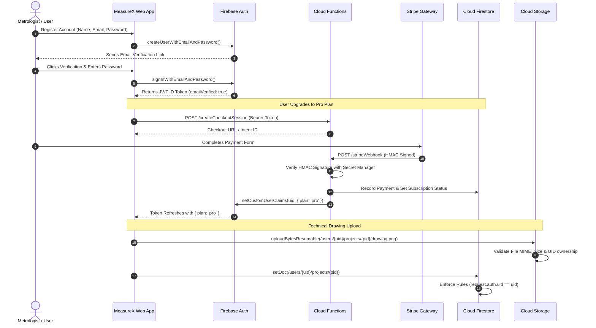

# MEASUREX – SECURE CLOUD ARCHITECTURE (PHASE 2)
**Document Version:** 1.0.0  
**Target Platform:** Google Cloud Platform (GCP) & Firebase Serverless  
**Security Standard:** Zero-Trust Architecture, ISO/IEC 27001, SOC 2 Type II Compatible  

---

## 1. Architectural Vision

MeasureX is architected as a **Zero-Trust, Serverless Cloud Metrology Platform**. The frontend remains a lightweight, high-performance React SPA running on Firebase Hosting edge locations worldwide, while all user data, authentication, technical drawings, calculation projects, and subscription entitlements are isolated, protected, and governed by Google Cloud backend services.

```mermaid
flowchart TD
    Client["MeasureX React Client (Light Aurora UI)"]
    AppCheck["Firebase App Check (reCAPTCHA Enterprise)"]
    Hosting["Firebase Hosting (Edge CDN + Strict CSP/HSTS)"]
    Auth["Firebase Auth (Identity Platform + MFA)"]
    Firestore["Cloud Firestore (Zero-Trust Security Rules)"]
    Storage["Firebase Cloud Storage (Private Enforced Buckets)"]
    Functions["Cloud Functions 2nd Gen (Node.js 20 Backend)"]
    SecretManager["GCP Secret Manager (Encrypted API & Webhook Secrets)"]
    PaymentGW["Payment Gateway (Stripe / Razorpay Webhooks)"]

    Client -->|HTTPS + App Check Token| Hosting
    Client -->|App Check Attestation| AppCheck
    Client -->|JWT ID Token Authentication| Auth
    Client -->|Authenticated Read/Write (Rules Isolated)| Firestore
    Client -->|Resumable Uploads / Short-Lived URLs| Storage
    PaymentGW -->|Cryptographic Signed Webhooks| Functions
    Functions -->|Fetch Webhook Secrets| SecretManager
    Functions -->|Update Subscription & Audit Logs| Firestore
    Functions -->|Issue Custom Claims (Role/Plan)| Auth
```

---

## 2. Core Cloud Infrastructure Components

### 2.1 Firebase Authentication (Google Cloud Identity Platform)
- **Role:** Identity, credential management, and session token issuance.
- **Protocol:** OIDC / OAuth2 with short-lived JWT ID tokens (1-hour lifespan) and automatic refresh token rotation.
- **Supported Providers:** Email/Password (scrypt hashing), Google OAuth 2.0.
- **Security Features:**
  - Mandatory Email Verification via signed activation links prior to cloud sync.
  - Custom Claims embedding user entitlement: `request.auth.token.plan` (`free`, `pro`, `enterprise`).
  - Account lockout after 5 consecutive failed login attempts.
  - Session revocation capability (`revokeRefreshTokens(uid)`).

### 2.2 Cloud Firestore (NoSQL Metrology Document Store)
- **Role:** Real-time synchronized database for projects, measurement logs, calibrations, and subscription status.
- **Deployment Mode:** Multi-region (e.g. `nam5` or `eur3`) for 99.999% availability.
- **Isolation Policy:** Subcollection user isolation (`/users/{userId}/**`).
- **Enforcement:** Declarative Firestore Security Rules with default-deny, preventing cross-tenant read/write and field tampering.

### 2.3 Firebase Cloud Storage (Private Engineering Vault)
- **Role:** Encrypted storage of technical blueprints, CAD exports, high-resolution specimen photos, and PDF metrology inspection reports.
- **Bucket Layout:** `gs://measurex-vault/users/{userId}/projects/{projectId}/{fileId}`.
- **Encryption:** Google-managed AES-256 encryption at rest; optional Customer-Managed Encryption Keys (CMEK) via Google Cloud KMS for Enterprise tier.
- **Access Control:** No public URLs. All access requires authenticated ownership tokens or short-lived signed URLs (15-minute expiration).

### 2.4 Firebase App Check (Abuse & Scraping Shield)
- **Role:** Verifies that incoming traffic originates from the legitimate, untampered MeasureX web app.
- **Attestation Provider:** reCAPTCHA Enterprise on Web, DeviceCheck / Play Integrity on mobile wrappers.
- **Protected Resources:** Cloud Firestore, Firebase Storage, and Cloud Functions.
- **Outcome:** Blocks automated headless bots, API scrapers, and malicious direct SDK calls from unauthorized origins.

### 2.5 Cloud Functions for Firebase (2nd Gen / Cloud Run)
- **Role:** Trusted server-side execution environment for privileged metrology and financial operations.
- **Runtime:** Node.js 20 ESM, containerized on Cloud Run with automatic concurrency and scale-to-zero.
- **Responsibilities:**
  - Webhook ingestion from payment providers with HMAC SHA-256 signature verification.
  - Setting user Custom Claims upon verified subscription payment.
  - Automated PDF report compilation and CAD DXF conversion using server headless engines.
  - Immutable audit logging to `/auditLogs`.
  - User account deletion orchestration (cascading removal of Auth, Firestore, and Storage objects).

### 2.6 Google Cloud Secret Manager
- **Role:** Centralized, hardware-security-module (HSM) backed vault for credentials.
- **Stored Secrets:**
  - `STRIPE_SECRET_KEY` / `RAZORPAY_KEY_SECRET`
  - `STRIPE_WEBHOOK_SECRET`
  - `SENDGRID_API_KEY` (for verification and invoice emails)
  - `BACKEND_SIGNING_PRIVATE_KEY`
- **Zero Frontend Leakage:** Secrets are injected into Cloud Functions at runtime via IAM service account bindings and are never present in repository code or client builds.

### 2.7 Firebase Hosting (Global Edge Distribution)
- **Role:** High-speed global edge delivery of static assets with HTTP/3 and automated Let's Encrypt SSL.
- **Security Headers Injected at Edge (`firebase.json`):**
  - `Content-Security-Policy`: Restricts script, style, image, and connect origins.
  - `Strict-Transport-Security`: `max-age=31536000; includeSubDomains; preload`.
  - `X-Frame-Options`: `DENY` (anti-clickjacking).
  - `X-Content-Type-Options`: `nosniff` (anti-MIME confusion).
  - `Referrer-Policy`: `strict-origin-when-cross-origin`.

---

## 3. Multi-Environment Architecture Strategy

MeasureX employs three completely isolated GCP/Firebase projects to ensure production data is never exposed to development or testing cycles:

| Environment | GCP Project ID | Purpose | Database Isolation | Storage Bucket |
|---|---|---|---|---|
| **Development** | `measurex-dev` | Local developer testing, Firebase Emulator Suite, automated CI unit tests | Isolated mock database | `measurex-dev-vault` |
| **Staging** | `measurex-stage` | Pre-production validation, integration testing with gateway test-mode webhooks | Separate staging instance | `measurex-stage-vault` |
| **Production** | `measurex-prod` | Live production service, real user technical blueprints, real gateway payments | Multi-region production cluster | `measurex-prod-vault` |

### Environment Isolation Rules:
1. **Zero Shared Credentials:** API keys, database URLs, and secret vaults are distinct per environment.
2. **Never Use Production Data in Lower Envs:** Synthetic test data and automated faker scripts generate all staging/dev test assets.
3. **IAM Least Privilege:** Developers hold viewer permissions in production and deploy exclusively through signed CI/CD pipelines (GitHub Actions / Cloud Build) with manual approval gates.

---

## 4. End-to-End Data Flow


