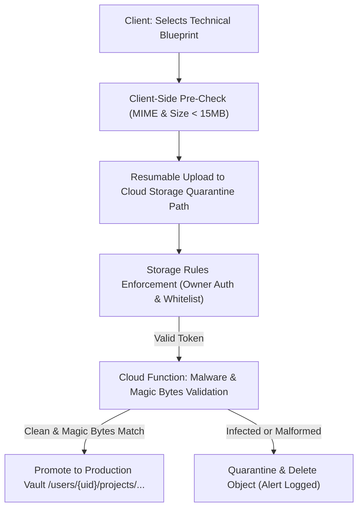

# MEASUREX – CONFIDENTIAL DOCUMENT & BLUEPRINT SECURITY
**Document Version:** 1.0.0  
**Storage Architecture:** Google Cloud Storage / Firebase Cloud Storage  
**Compliance Baseline:** Defense & Aerospace Technical Data Standard (NIST SP 800-171)  

---

## 1. Security Scope

MeasureX users upload confidential engineering drawings, patent diagrams, aerospace turbine part scans, automotive tolerance blueprints, and official metrology reports. A security breach of these documents could compromise proprietary intellectual property.

---

## 2. Storage Security Principles

1. **Private by Default**: Storage buckets have **public read disabled**. There are no publicly accessible URLs.
2. **Short-Lived Ephemeral Access**: File downloads execute either directly via authenticated Firebase Storage SDK session tokens or through cryptographically signed V4 download URLs with a **maximum lifespan of 15 minutes**.
3. **Randomized Object Keys**: File paths use UUIDv4 identifiers. Original filenames uploaded by users are stored as encrypted metadata in Firestore, preventing predictable object scanning.

```
gs://measurex-vault/users/{userId}/projects/{projectId}/{uuidv4}.enc
```

---

## 3. Upload Validation & Antivirus Pipeline



### 3.1 Strict MIME Whitelist & Magic Bytes Inspection
File extensions can be forged by attackers (e.g. `exploit.php.png`). MeasureX verifies both the HTTP MIME header and the binary file signature (magic bytes):

| Allowed Format | File Extension | Declared MIME Type | Magic Bytes Signature (Hex) | Max Size |
|---|---|---|---|---|
| **Portable Network Graphics** | `.png` | `image/png` | `89 50 4E 47 0D 0A 1A 0A` | 15 MB |
| **JPEG Image** | `.jpg`, `.jpeg` | `image/jpeg` | `FF D8 FF E0` or `FF D8 FF E1` | 15 MB |
| **WebP Image** | `.webp` | `image/webp` | `52 49 46 46 ... 57 45 42 50` | 15 MB |
| **PDF Metrology Report** | `.pdf` | `application/pdf` | `25 50 44 46` (`%PDF-`) | 10 MB |
| **CAD Vector Drawing** | `.dxf`, `.svg` | `image/svg+xml` | XML header + `<svg` tag verification | 10 MB |

### 3.2 Anti-Malware & Web Shell Scanning
- **Asynchronous Cloud Function Hook (`onObjectFinalized`)**:
  - Validates file magic bytes against the declared MIME type.
  - Passes buffer through Google Cloud Security Command Center / ClamAV daemon.
  - If malicious signatures or embedded PHP/JavaScript `<script>` tags are discovered inside SVGs or image EXIF headers, the object is immediately deleted and the event is recorded in `/auditLogs`.

---

## 4. Path Traversal & Filename Sanitization

Attackers frequently attempt directory traversal attacks (e.g., `../../../etc/passwd` or `..\Windows\System32`).

### Sanitization Implementation:
```typescript
import path from 'path';
import { v4 as uuidv4 } from 'uuid';

export const sanitizeAndGenerateStoragePath = (
  userId: string,
  projectId: string,
  originalFilename: string
): { storagePath: string; safeName: string } => {
  // 1. Strip path components
  const baseName = path.basename(originalFilename);

  // 2. Remove non-whitelisted characters
  const safeName = baseName.replace(/[^a-zA-Z0-9._-]/g, '_');

  // 3. Prohibit dangerous executable extensions
  const forbiddenExts = ['.exe', '.bat', '.cmd', '.sh', '.php', '.js', '.html', '.vbs', '.py'];
  const ext = path.extname(safeName).toLowerCase();
  if (forbiddenExts.includes(ext)) {
    throw new Error('Forbidden file extension detected.');
  }

  // 4. Generate randomized UUID storage object
  const storagePath = `users/${userId}/projects/${projectId}/${uuidv4()}${ext}`;
  return { storagePath, safeName };
};
```

---

## 5. Short-Lived Signed URL Generation

When an authorized user requests to view or download a high-resolution blueprint, the server issues a time-bound signed URL:

```typescript
import { Storage } from '@google-cloud/storage';

const storage = new Storage();
const bucket = storage.bucket('measurex-vault');

export const generateSecureDownloadUrl = async (
  userId: string,
  projectId: string,
  fileId: string,
  requestingUserId: string
): Promise<string> => {
  // Strict Ownership Enforcement
  if (userId !== requestingUserId) {
    throw new Error('Unauthorized: You do not own this document.');
  }

  const file = bucket.file(`users/${userId}/projects/${projectId}/${fileId}`);
  const [exists] = await file.exists();
  if (!exists) {
    throw new Error('Document not found.');
  }

  // Generate V4 Signed URL with 15-minute expiration
  const [signedUrl] = await file.getSignedUrl({
    version: 'v4',
    action: 'read',
    expires: Date.now() + 15 * 60 * 1000, // 15 minutes
  });

  return signedUrl;
};
```

---

## 6. Secure Document Deletion & Sanitization

1. **Immediate Purge**: When a project or blueprint is deleted by the user, the application issues an asynchronous deletion command to Cloud Storage:
   ```typescript
   await file.delete({ ignoreNotFound: true });
   ```
2. **Zero Metadata Leakage in Logs**: Application logs **must never record** user document contents, raw image buffers, or proprietary drawing file names. Logs only record anonymized IDs:
   ```json
   { "event": "DOCUMENT_DELETED", "userId": "usr_9981", "fileId": "uuid_782f" }
   ```
