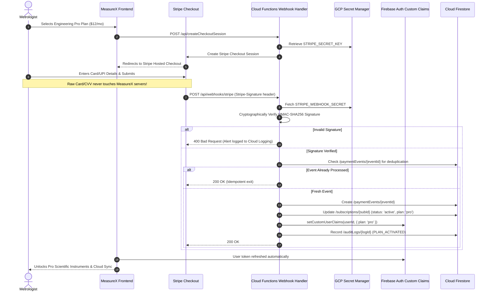

# MEASUREX – SUBSCRIPTION & PAYMENT SECURITY (PHASE 6)
**Document Version:** 1.0.0  
**Target Services:** Cloud Functions 2nd Gen, Stripe API / Razorpay API, GCP Secret Manager  
**Compliance Standard:** PCI-DSS Level 1 Merchant Policy (SAQ-A Compliant)  

---

## 1. Zero-Trust Entitlement Philosophy

In MeasureX, **frontend state is considered inherently untrusted**. A client application cannot grant, modify, or extend a subscription plan. All plan capabilities, feature gating, and database access are enforced by backend cryptographic checks and Firestore security rules.



---

## 2. Server-Controlled Subscription Lifecycle

### 2.1 Supported Subscription Tiers

| Feature Tier | Price | Verification Mechanism | Gated Capabilities |
|---|---|---|---|
| **Starter Basic** | $0 (Free) | Default upon registration | Quick Measure, Unit Converter, Basic Caliper, local-only projects (max 5) |
| **Engineering Pro** | $12/mo (Annual) / $19/mo | Server webhook verified | All 15 Scientific Instruments, Synchronized 3-Sided Studio, Unlimited Cloud Sync, PDF Reports, Specimen Test Bench |
| **Enterprise Lab** | $34/mo (Annual) / $49/mo | Server webhook verified | Industrial GD&T Tolerance Engine, CAD DXF Vector Exporter, Multi-Seat Team Workspaces, Calibration Tracking, 24/7 Priority Support |

---

## 3. Payment Gateway Webhook Verification

### 3.1 Cryptographic Signature Validation
All incoming webhook notifications must be verified before parsing:

```typescript
import { Request, Response } from 'express';
import Stripe from 'stripe';
import { getSecret } from './secretManager';
import { db, adminAuth } from './firebaseAdmin';

export const handleStripeWebhook = async (req: Request, res: Response) => {
  const sig = req.headers['stripe-signature'] as string;
  const webhookSecret = await getSecret('STRIPE_WEBHOOK_SECRET');
  const stripeSecretKey = await getSecret('STRIPE_SECRET_KEY');

  const stripe = new Stripe(stripeSecretKey, { apiVersion: '2023-10-16' });

  let event: Stripe.Event;

  try {
    // Cryptographic validation against raw buffer
    event = stripe.webhooks.constructEvent(req.rawBody, sig, webhookSecret);
  } catch (err: any) {
    console.error(`Webhook signature verification failed: ${err.message}`);
    return res.status(400).send(`Webhook Error: ${err.message}`);
  }

  // Idempotency check: prevent replay attacks
  const eventRef = db.collection('paymentEvents').doc(event.id);
  const existingEvent = await eventRef.get();

  if (existingEvent.exists) {
    console.log(`Duplicate event ${event.id} ignored.`);
    return res.status(200).json({ received: true, deduplicated: true });
  }

  // Record event in ledger before processing
  await eventRef.set({
    id: event.id,
    type: event.type,
    gateway: 'stripe',
    processedAt: new Date(),
    status: 'processing',
  });

  // Handle Event Types
  switch (event.type) {
    case 'checkout.session.completed': {
      const session = event.data.object as Stripe.Checkout.Session;
      await activateUserSubscription(session);
      break;
    }
    case 'customer.subscription.updated': {
      const subscription = event.data.object as Stripe.Subscription;
      await syncSubscriptionStatus(subscription);
      break;
    }
    case 'customer.subscription.deleted': {
      const subscription = event.data.object as Stripe.Subscription;
      await revokeSubscription(subscription);
      break;
    }
  }

  await eventRef.update({ status: 'completed' });
  return res.status(200).json({ received: true });
};
```

---

## 4. Anti-Tampering & Security Protections

1. **SAQ-A PCI-DSS Compliance (Zero Card Data on MeasureX)**:  
   Card numbers, expiration dates, and CVVs are entered directly on Stripe/Razorpay hosted fields. MeasureX servers, databases, and logs never receive, transmit, or store raw cardholder data.

2. **Deduplication & Replay Attack Defense**:  
   Every payment event has a unique gateway ID. The `/paymentEvents/{eventId}` collection ensures that an intercepted or duplicated webhook can never grant double subscriptions or re-activate expired accounts.

3. **Backend-Enforced Feature Gates**:  
   Premium operations (such as generating an official PDF metrology inspection certificate or compiling a CAD DXF drawing) run as authenticated Cloud Functions. The backend checks:
   ```typescript
   if (context.auth?.token.plan !== 'pro' && context.auth?.token.plan !== 'enterprise') {
     throw new HttpsError('permission-denied', 'Engineering Pro subscription required.');
   }
   ```
   Even if an attacker modifies client code to display the button, the server call rejects the operation.
