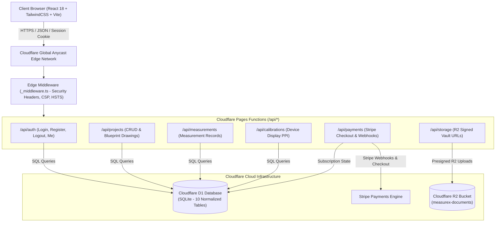

# 📐 MeasureX — Universal Precision Digital Metrology & Blueprint Platform

[](https://github.com/simransimran20704-cloud/measurex)
[-success.svg?style=flat-square)](https://github.com/simransimran20704-cloud/measurex)
[](https://www.typescriptlang.org/)
[](https://react.dev/)
[](https://vitejs.dev/)
[](https://pages.cloudflare.com/)
[](https://developers.cloudflare.com/d1/)
[](LICENSE)

**MeasureX** is an enterprise-grade digital metrology workstation and blueprint measurement platform engineered for engineers, machinists, quality inspectors, educators, and laboratory researchers. It pairs sub-millimeter on-screen measurement tools and realistic scientific instruments with a serverless edge backend powered by Cloudflare Pages Functions, Cloudflare D1 (SQLite), and Cloudflare R2 storage.

---

## 🌟 Key Features

### 1. 🔬 Virtual Scientific Metrology Lab
Realistic simulation and interactive measurement instruments with micro-step precision and haptic audio feedback:
- **Vernier Caliper**: Dual metric/imperial vernier scale with internal jaws, external jaws, depth probe, and zero-error calibration.
- **Screw Gauge (Micrometer)**: Circular thimble rotation with 0.01 mm least count, ratchet stop, and positive/negative zero error correction.
- **Vernier Height Gauge**: Precision scriber height measurement for surface-plate layout work.
- **Dial Test Indicator (DTI)**: Runout measurement with sensitive plunger travel, rotational bezel, and deviation needle.
- **Feeler Gauge**: Blade thickness stacker (0.02 mm – 1.00 mm) for precision gap clearance analysis.
- **Thread Pitch Gauge**: Unified (UN) and Metric (M) profile overlays for fastener pitch inspection.
- **Spherometer**: Three-legged curvature measurement for calculating the radius of spherical optical lenses and surfaces.
- **Spirit Level**: Dual-axis sensitivity bubble inclinometer for surface leveling and plane verification.
- **Digital Protractor**: High-accuracy 360° angle finder with complementary and supplementary angle readout.
- **PCD (Pitch Circle Diameter) Generator**: Bolt-circle hole pattern coordinate generator for CAD/CAM drilling.
- **Limits & Fits Calculator**: ISO 286 hole/shaft engineering tolerance and clearance/interference/transition fit calculator.
- **Precision Digital Scale**: Virtual tare and calibration balance for small mass metrology.
- **Interactive Metrology Quiz**: Metrology knowledge certification and quiz suite for engineering trainees.

### 2. 📏 Dynamic Screen Calibration Engine
- Automatic display PPI estimation based on hardware device pixel ratios.
- **ISO/IEC 7810 ID-1 Physical Calibration**: Place any standard bank card (85.60 mm × 53.98 mm) on screen for 1-click true-to-life 1:1 scale calibration.
- Coin and custom gauge block calibration modes with manual micrometer slider fine-tuning.

### 3. 📐 Blueprint Precision Studio & Image Measurement
- High-resolution CAD blueprint and technical photo digitizer.
- Multi-point polygon tracing with real-time length, perimeter, and surface area calculation.
- Coordinate grid snapping, rotation, and dynamic aspect-ratio scaling.
- Export measurements directly to PDF reports, CSV data tables, and high-resolution annotated drawings.

### 4. ⚡ Serverless Edge Architecture (Cloudflare Pages Functions)
- **Zero Cold Starts**: Globally distributed Pages Functions running on Cloudflare's V8 edge network.
- **Relational Edge Database**: Powered by Cloudflare D1 with foreign key enforcement and indexed queries.
- **Private Document Vault**: Integrated with Cloudflare R2 for secure blueprint and PDF invoice storage.

### 5. 🔏 Zero-Trust Security & Authentication
- **PBKDF2 Password Hashing**: Web Crypto API implementation with 600,000 iterations and cryptographic salts.
- **Tamper-Proof Session Management**: `__Host-` prefixed `HttpOnly`, `Secure`, `SameSite=Lax` cookies with SHA-256 session token hashing.
- **BOLA / IDOR Defense**: Strict user ownership validation on every database query and mutation.
- **Payment Security**: Cryptographic HMAC-SHA256 Stripe webhook signature verification with replay attack defense.

### 6. 💳 Multi-Tier Subscription & Enterprise Billing
- Flexible plans: **Free**, **Pro**, and **Enterprise** with role-based feature gating.
- Dynamic client-side and server-side PDF invoice generation via `jspdf`.
- Multi-currency support (USD, INR, EUR, GBP) with automatic tax and GST/VAT calculations.

---

## 🏗️ Architecture Overview



---

## 🛠️ Technology Stack

| Layer | Technologies |
| :--- | :--- |
| **Frontend Framework** | [React 18.3](https://react.dev/), [TypeScript 5.7](https://www.typescriptlang.org/), [Vite 6.1](https://vitejs.dev/) |
| **Styling & Icons** | [Tailwind CSS 3.4](https://tailwindcss.com/), [Lucide React](https://lucide.dev/), [clsx](https://github.com/lukeed/clsx), [tailwind-merge](https://github.com/dcastil/tailwind-merge) |
| **State Management** | [Zustand 5.0](https://github.com/pmndrs/zustand) (Persistent Local & Cloud Stores) |
| **PDF & Canvas** | [jsPDF 2.5](https://github.com/parallax/jsPDF), [canvas-confetti](https://github.com/catdad/canvas-confetti) |
| **Backend & Edge** | [Cloudflare Pages Functions](https://developers.cloudflare.com/pages/functions/), Web Crypto API |
| **Database** | [Cloudflare D1](https://developers.cloudflare.com/d1/) (Distributed Serverless SQLite) |
| **Object Storage** | [Cloudflare R2](https://developers.cloudflare.com/r2/) (S3-Compatible Private Vault) |
| **Testing** | [Vitest 5.1](https://vitest.dev/) (Unit, Engine Math, Security Remediation Suites) |

---

## 📁 Repository Structure

```text
MeasureX/
├── functions/                     # Cloudflare Pages Functions (Edge Backend)
│   ├── _middleware.ts             # Global Security Headers, HSTS, CSP Middleware
│   ├── api/
│   │   ├── auth/                  # /api/auth (login, logout, register, me)
│   │   ├── calibrations/          # /api/calibrations (display PPI sync)
│   │   ├── measurements/          # /api/measurements (recording and history)
│   │   ├── payments/              # /api/payments (Stripe checkout & webhook)
│   │   ├── projects/              # /api/projects (CRUD & blueprint coordinates)
│   │   └── storage/               # /api/storage (R2 secure upload signatures)
│   └── utils/                     # Edge Auth, Password Hashing & Crypto Helpers
├── migrations/                    # Cloudflare D1 SQL Schema Migrations
│   ├── 0001_initial_schema.sql    # 10 Normalized Tables with FK & Indexes
│   └── 0002_seed_data.sql         # Production-Safe Migration (0 demo credentials)
├── public/                        # Static Assets & Cloudflare Headers
│   └── _headers                   # HTTP Security & Cache-Control Policies
├── src/                           # Frontend React Application
│   ├── engine/                    # Core Metrology Math & Calibration Engines
│   │   ├── calibration/           # Screen Calibration & Reference Standards
│   │   ├── conversion/            # Unit Conversions (Length, Area, Volume, etc.)
│   │   ├── geometry/              # Polygon Area, Distance & Angle Calculation
│   │   └── instruments/           # Vernier & Screw Gauge Math Simulators
│   ├── components/                # Reusable UI & Layout Components
│   ├── modules/                   # Feature Views (Instruments, Studio, Billing)
│   │   ├── scientific-instruments/# 12 Precision Scientific Instrument Views
│   │   ├── precision-studio/      # CAD Blueprint & Polygon Trace Workspace
│   │   ├── subscription/          # Pricing, Billing & Checkout Modals
│   │   └── ...                    # Quick Measure, Unit Converter, Export
│   ├── services/                  # API Client & Browser Web Crypto Helpers
│   ├── stores/                    # Zustand Stores (App, Auth, Calibration, Projects)
│   ├── tests/                     # Vitest Automated Test Suites (57 tests)
│   └── types/                     # TypeScript Interfaces & Metrology Types
├── CLOUDFLARE_DEPLOYMENT_CHECKLIST.md  # Production Deployment Specification
├── package.json                   # Project Manifest & NPM Scripts
├── tailwind.config.js             # Tailwind CSS Configuration
├── tsconfig.json                  # TypeScript Compiler Settings
├── vite.config.ts                 # Vite Build Configuration
└── wrangler.toml                  # Cloudflare Pages, D1 & R2 Deployment Manifest
```

---

## 🚀 Getting Started

### Prerequisites
- **Node.js**: `v18.0.0` or higher
- **NPM**: `v9.0.0` or higher
- **Cloudflare Wrangler CLI** *(for edge functions & D1 local testing)*:
  ```bash
  npm install -g wrangler
  ```

### Installation

1. **Clone the repository:**
   ```bash
   git clone https://github.com/simransimran20704-cloud/measurex.git
   cd measurex
   ```

2. **Install project dependencies:**
   ```bash
   npm install
   ```

3. **Start the local development server:**
   ```bash
   npm run dev
   ```
   Open [http://localhost:3000](http://localhost:3000) in your browser.

---

## 🧪 Testing & Quality Assurance

MeasureX includes an automated test suite verifying instrument mathematical precision, unit conversions, geometric polygon calculations, authentication mechanisms, and edge security:

```bash
# Run the complete automated test suite
npm test
```

### Test Suite Summary (57 Tests):
- `src/tests/instruments.test.ts`: Vernier least count, micrometer circular thimble calculations, and zero-error corrections.
- `src/tests/geometry.test.ts`: Multi-point polygon shoelace area, perimeter, and coordinate transformations.
- `src/tests/conversion.test.ts`: High-precision metric/imperial conversions across 6 dimension categories.
- `src/tests/measurement.test.ts`: Screen calibration pixel-to-millimeter ratios.
- `src/tests/authAndBilling.test.ts`: Client-side validation, invoice calculations, and plan tier permissions.
- `src/tests/securityRemediation.test.ts`: Web Crypto PBKDF2 600,000-iteration password hashing, session tokens, and IDOR prevention.
- `src/tests/advancedTools.test.ts`: PCD bolt-circle generation, Limits & Fits tolerance calculations.

---

## 📦 Building for Production

To create an optimized production build:

```bash
npm run build
```

The compiled assets will be emitted to the `dist/` directory, ready for deployment to Cloudflare Pages.

---

## ☁️ Cloudflare Deployment

### 1. D1 Database Creation & Migration
```bash
# 1. Create remote D1 database
npx wrangler d1 create measurex-db

# 2. Update wrangler.toml with your database_id

# 3. Apply SQL migrations to the remote database
npx wrangler d1 migrations apply measurex-db --remote
```

### 2. R2 Document Vault Creation
```bash
npx wrangler r2 bucket create measurex-documents
```

### 3. Provision Cloudflare Secrets
```bash
# Set Stripe Secret Key
npx wrangler pages secret put STRIPE_SECRET_KEY

# Set Stripe Webhook Secret
npx wrangler pages secret put STRIPE_WEBHOOK_SECRET
```

### 4. Deploy to Cloudflare Pages
```bash
npx wrangler pages deploy dist
```

---

## 📄 License

This project is licensed under the **MIT License** — see the [LICENSE](LICENSE) file for details.

---

<p align="center">
  Crafted with precision for dimensional metrology & engineering excellence.
</p>
